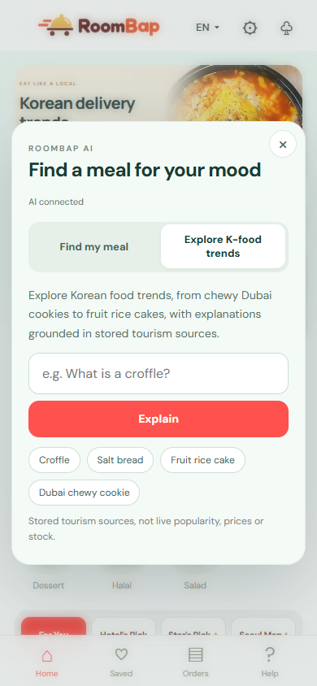

# RoomBap

> **2026 SOGANG AI LAUNCHPAD AI 창업캠프 우수상 수상작**

외국인 호텔 투숙객을 위한 AI 음식 추천·한국 유행 음식 안내 및 주문 시연 서비스입니다.

## Project Information

- **목표:** 외국인 투숙객이 익숙하지 않은 한국 음식을 이해하고 취향에 맞는 메뉴를 선택하도록 지원
- **주요 기능:** 취향 설정, 자연어 음식 추천, 출처 기반 음식 설명, 메뉴 탐색과 주문 시연

## Project Result

- **[RoomBap 서비스 실행링크](https://roombap.secretwasp34.chatgpt.site)**
- 매장 **50개**·메뉴 **144개**를 공통 카탈로그로 관리하며 영어·일본어·중국어 취향 설정 지원
- 실제 AI 추천·음식 설명·시연 주문 흐름 확인, 자동 검사 **241개 통과**

 

## Project Details

| 구분 | 구현 내용 |
| --- | --- |
| AI 음식 추천 | Claude로 요청 조건 추출 → 메뉴 조건 검증 → MiniLM 벡터·태그 기반 순위 계산 |
| 한국 유행 음식 안내 | 등록 자료 검색(RAG) → Claude 설명 생성·근거 대조 → 출처 표시 |
| 탐색·주문 시연 | 카테고리·지도·음식 콘텐츠 탐색, 메뉴 옵션·장바구니·모의 결제·주문 상태 표시 |

추천 조건을 메뉴 정보로 확인할 수 없으면 보류하거나 빈 결과를 반환합니다. 알레르기·식단 안전성을 보장하지 않으며, 실제 결제·주문 전송·배달은 처리하지 않습니다. 유행 음식 안내는 저장된 자료에 근거합니다.

## 기술 스택

| 구분 | 기술 |
| --- | --- |
| Frontend | HTML, CSS, JavaScript |
| Backend | Node.js, Cloudflare Workers |
| AI·검색 | Claude API, MiniLM 임베딩, RAG |
| 배포 | Sites / Cloudflare Workers |

## Authors

### 김민주 | 조사

- 서강대학교 경영학 학사과정

### 김은주 | 조사

- 서강대학교 경영학 학사과정

### 김재학 | 개발

- 서강대학교 수학 & 컴퓨터공학 학사과정

### 김진서 | 디자인

- 서강대학교 아트앤테크놀로지학 학사과정

### 이성빈 | 개발

- 서강대학교 영문학 학사과정

### 최정우 | 팀장

- 서강대학교 경영학 학사과정

## 실행 방법

**Node.js 24 이상**에서 프로젝트 폴더를 열고 실행합니다. 기본 실행에는 별도 패키지 설치가 필요하지 않습니다.

```sh
node --env-file-if-exists=.env scripts/preview-local.mjs
```

브라우저에서 **http://127.0.0.1:8793/** 에 접속합니다. 로컬 AI 사용 시 `.env.example`을 `.env`로 복사하고 본인의 `ANTHROPIC_API_KEY`와 사용 가능한 `CLAUDE_MODEL`을 설정합니다. API 사용 비용은 해당 계정에 발생하며 `.env`는 Git에서 제외됩니다.

자세한 내용: [전체 구조](docs/ARCHITECTURE.md) · [메뉴 데이터 관리](docs/CATALOG_SYNC.md) · [검사·주문 동작](docs/CART_ORDER_FIXES.md) · [설문·AI 사용 안내](docs/PRIVACY_NOTICES.md)
