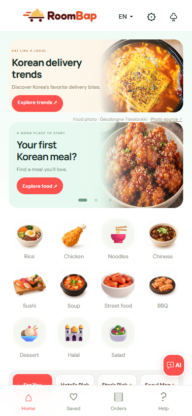
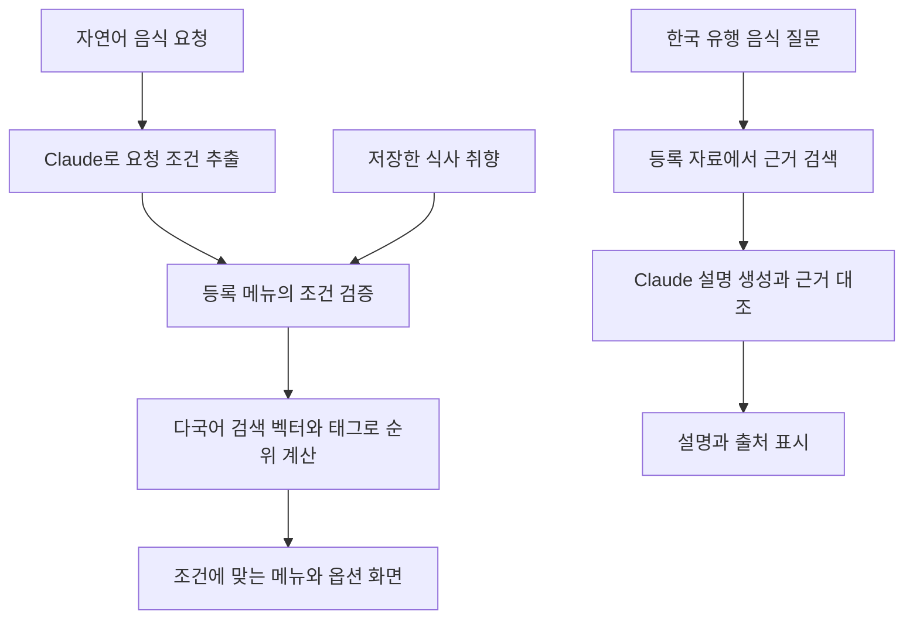

# RoomBap

**2026 SOGANG AI LAUNCHPAD AI 창업캠프 우수상 수상작**

**[🌐 서비스 실행하기](https://roombap.secretwasp34.chatgpt.site)**

외국인 호텔 투숙객을 위한 AI 음식 추천·한국 유행 음식 안내 및 주문 시연 서비스입니다.

## 주요 기능

| 기능 | 설명 |
| --- | --- |
| 취향 설정 | 영어·일본어·중국어로 식사 방식, 피하는 재료, 매운맛, 알레르기 선택 |
| AI 음식 추천 | 자연어 요청에서 음식·맛·기본 가격 조건을 추출하고 등록된 메뉴와 대조 |
| 한국 유행 음식 안내 | 두바이 쫀득 쿠키·크로플 등 등록된 음식 주제를 근거 자료와 출처로 설명 |
| 음식 탐색 | 카테고리, 저장한 매장, Hotel’s Pick, Star’s Pick, 서울 지도와 음식 문화 콘텐츠 |
| 주문 시연 | 메뉴 옵션·수량 선택, 장바구니, 최소 주문금액 확인, 모의 결제와 주문 상태 표시 |



## 실행 방법

**Node.js 24 이상**을 사용합니다. 기본 로컬 실행에는 패키지 설치, Python 또는 데이터베이스가 필요하지 않습니다. 검색 벡터도 저장소에 포함되어 있습니다.

```sh
git clone https://github.com/jaehakie/RoomBap.git
cd RoomBap
node scripts/preview-local.mjs
```

브라우저에서 **http://127.0.0.1:8793/** 을 엽니다. 키 없이도 메뉴 탐색·설문·장바구니·시연 주문을 확인할 수 있습니다. AI 질문을 처리하려면 다음 설정이 필요합니다.

### Claude 연결

1. 프로젝트 루트의 `.env.example`을 `.env`라는 이름으로 복사합니다.
2. `ANTHROPIC_API_KEY`에 본인의 Claude API 키를 입력합니다.
3. `CLAUDE_MODEL`에 해당 API 계정에서 사용할 수 있는 모델 ID를 입력합니다.
4. 실행 중인 서버를 종료한 뒤 다음 명령으로 시작합니다.

```sh
node --env-file=.env scripts/preview-local.mjs
```

API 키는 서버에서 읽으며 브라우저에 포함하지 않습니다. `.env`는 Git 업로드 대상에서 제외됩니다. 연결한 API 계정에는 사용량에 따른 비용이 발생할 수 있습니다.

이미 8793 포트를 사용 중이라면 실행 명령 뒤에 `--port 8794`를 붙여 다른 포트에서 실행할 수 있습니다.

## AI 처리 방식



- **메뉴 추천:** Claude로 요청 조건을 추출하고, 메뉴 검증과 MiniLM 벡터·태그 점수로 결과를 정합니다.
- **근거 기반 설명(RAG):** 8개 음식 주제·12개 근거 요약을 검색하고, Claude로 설명 생성과 근거 대조를 수행합니다.
- **결과 검증:** 등록되지 않은 메뉴·가격·인용 근거를 차단하며, 검증 불가 조건이나 오류에 가짜 결과를 제공하지 않습니다.

자세한 정보 흐름과 실행 구성은 [구조 설명](docs/ARCHITECTURE.md)을 참고합니다.

## 데이터와 시연 범위

- 매장 **50개**, 메뉴 **144개**를 공통 카탈로그에서 관리합니다. 참고 자료를 연결한 메뉴와 설명용 시연 메뉴를 함께 포함합니다.
- 가격·옵션·영업·품절·배달비·최소 주문금액은 시연 데이터입니다. 실제 제휴 매장이나 실시간 배달 가능 여부를 뜻하지 않습니다.
- 알레르기·채식·비건·할랄·특정 재료 제외를 보장할 만큼 검증된 메뉴 정보는 제공하지 않습니다. 선택 조건을 확인할 수 없으면 추천을 보류하거나 결과가 없을 수 있습니다. 음식 종류나 매장 카테고리로 안전성을 추정하지 않습니다.
- 유행 음식 안내는 저장된 관광 자료에 근거하며 실시간 인기 순위·가격·재고를 제공하지 않습니다. AI의 근거 대조는 사람의 사실 확인을 대체하지 않습니다.
- 실제 결제·식당 주문 전송·배달·호텔 QR 인증은 처리하지 않습니다. 취향·장바구니·주문 기록은 브라우저 세션 단위로 보관합니다.
- 추천을 요청하면 설문 선택값이 서버로 전달되고, 입력한 질문은 외부 AI 서비스 Claude에서 처리됩니다. 주문 화면의 이름·전화번호를 AI 요청에 자동 첨부하지 않습니다. 자세한 내용은 [설문·AI 사용 안내](docs/PRIVACY_NOTICES.md)를 참고합니다.

## 검사와 메뉴 수정

```sh
node --test server/*.test.mjs tests/*.test.mjs
node scripts/catalog-check.mjs
node scripts/check-design-baseline.mjs
```

자동 검사는 조건 유지, 잘못된 모델 응답 차단, 메뉴 버전 일치, 장바구니 수정 취소·확정, 주문번호 및 중복 주문 방지를 확인합니다. 브라우저 확인 자료는 `docs/`의 기능별 검증 폴더에 보관합니다. 자동 검사에서는 유료 AI를 호출하지 않습니다.

메뉴 편집 원본은 **`data/catalog.json`** 입니다. 화면 데이터와 서버 데이터는 같은 원본에서 생성합니다. 변경·벡터 재생성 방법은 [메뉴 데이터 관리](docs/CATALOG_SYNC.md)를 참고합니다.

## 주요 폴더

```text
public/          화면 스크립트·스타일·이미지·지도 라이브러리
server/          페이지 HTML·AI API·프롬프트·서버 데이터·검사
data/            공통 메뉴 원본·메뉴 ID 등록부
shared/          카탈로그 변환·장바구니 검증
scripts/         로컬 실행·데이터 생성·검증 도구
tests/           장바구니·주문 동작 검사
worker/          Sites / Cloudflare Workers 요청 처리
docs/            구조·기능 설명·검증 결과·화면 예시
```

`app/`, `lib/`, `vite.config.ts` 등은 Sites/Vinext 빌드 구성입니다. 기본 실행에는 위의 Node.js 명령을 사용하며, GitHub 업로드만으로 사이트가 배포되지는 않습니다.

## 참고 문서

- [전체 구조와 AI 처리 흐름](docs/ARCHITECTURE.md)
- [공통 메뉴 데이터와 버전 관리](docs/CATALOG_SYNC.md)
- [화면과 AI 팝업 구성](docs/DESIGN_CHANGE.md)
- [장바구니·주문 동작](docs/CART_ORDER_FIXES.md)
- [설문·AI 사용 안내](docs/PRIVACY_NOTICES.md)

음식 자료의 출처·확인일은 관련 데이터에, 이미지·지도·콘텐츠의 출처 표기는 프론트엔드 자료와 각 화면에 보관합니다. 외부 자료 및 라이브러리의 출처·고지는 유지합니다.
